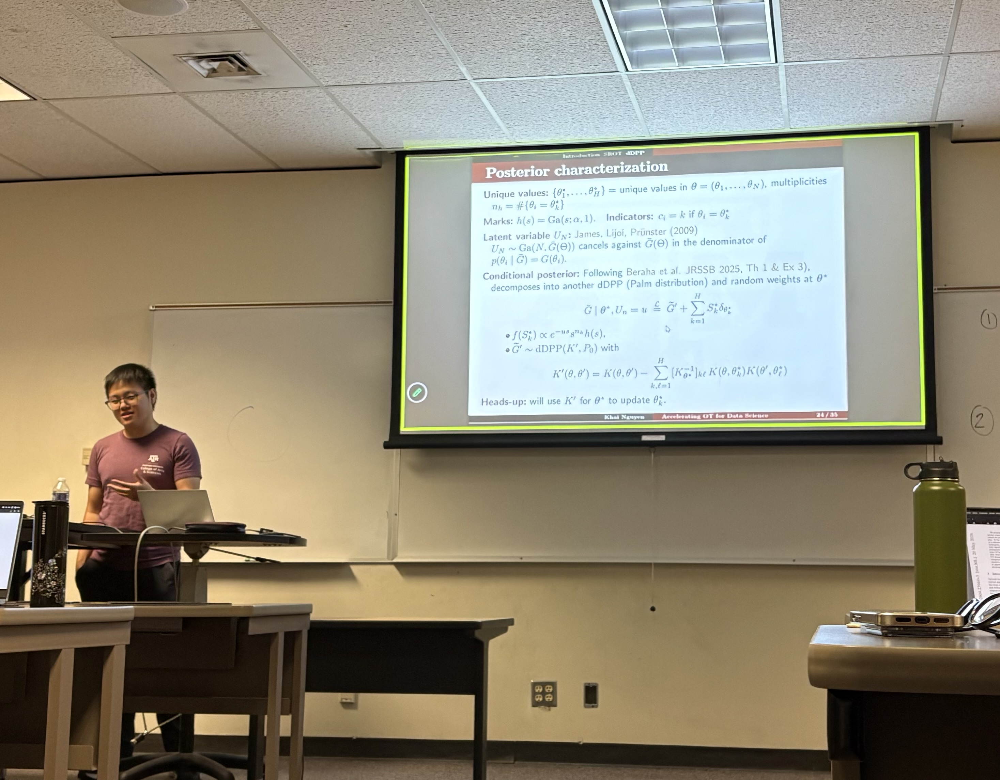

<!--
 
-->

### cyclinbayes: Bayesian Causal Discovery for Acyclic and Cyclic Graphical Models

- Time: Tuesday, 11/10/2026 from 11:10AM to 12:25PM
- Location: BLOC 448

[RSVP Link](<https://urldefense.com/v3/__https://forms.gle/UFP4Hu741TW5H48MA__;!!KwNVnqRv!Bqri47AAmc0Uv2mtlvb4VB2X1QRuisfcZTJFOttjc1FjEm495822iGgpvyn1c_e1Dy6vChWwv2K_Z9WN8eEp2F8$>)

[Zoom Link](<https://tamu.zoom.us/j/95358404036?pwd=aKGbZrMI8DlOuTvKXaabFQPyrYsPnM.1>)

### Description

Causal discovery aims to identify causal relationships among variables from observational data. Existing approaches for linear non-Gaussian models often focus on point estimation, providing limited information about uncertainty in the inferred causal structures. In this talk, I will introduce cyclinbayes, an R package for Bayesian causal discovery in both directed acyclic and cyclic graphical models. The package uses MCMC algorithms and sparsity-inducing priors to learn causal structures and coefficients while quantifying posterior uncertainty. I will highlight its main features, including posterior edge probabilities, credible intervals, decision theoretic graph selection.

### Our Speaker

Robert Lee is a fourth-year Ph.D. student in Statistics at Texas A&M University, advised by Dr. Raymond K. W. Wong and Dr. Yang Ni. He received his B.S. in Applied Mathematics with a minor in Statistics from the University of California, Berkeley. His research focuses on Bayesian causal discovery, graphical models, and statistical methodology for analyzing different types of data, with an emphasis on developing computational methods and software for understanding complex relationships among variables.

<!--
### Presentation
<iframe src="https://drive.google.com/file/d/1tN9MfS-UIcedYkMafjpg1VxsRcSM0t8T/preview" width="640" height="480" allow="autoplay"></iframe>
-->

<!--
### Recording
<iframe width="560" height="315" src="https://www.youtube.com/embed/hEnEmymzzU0?si=wj7aBvE_v2OlDE-k" title="YouTube video player" frameborder="0" allow="accelerometer; autoplay; clipboard-write; encrypted-media; gyroscope; picture-in-picture; web-share" referrerpolicy="strict-origin-when-cross-origin" allowfullscreen></iframe>
-->

<!--
### Gallery


-->

