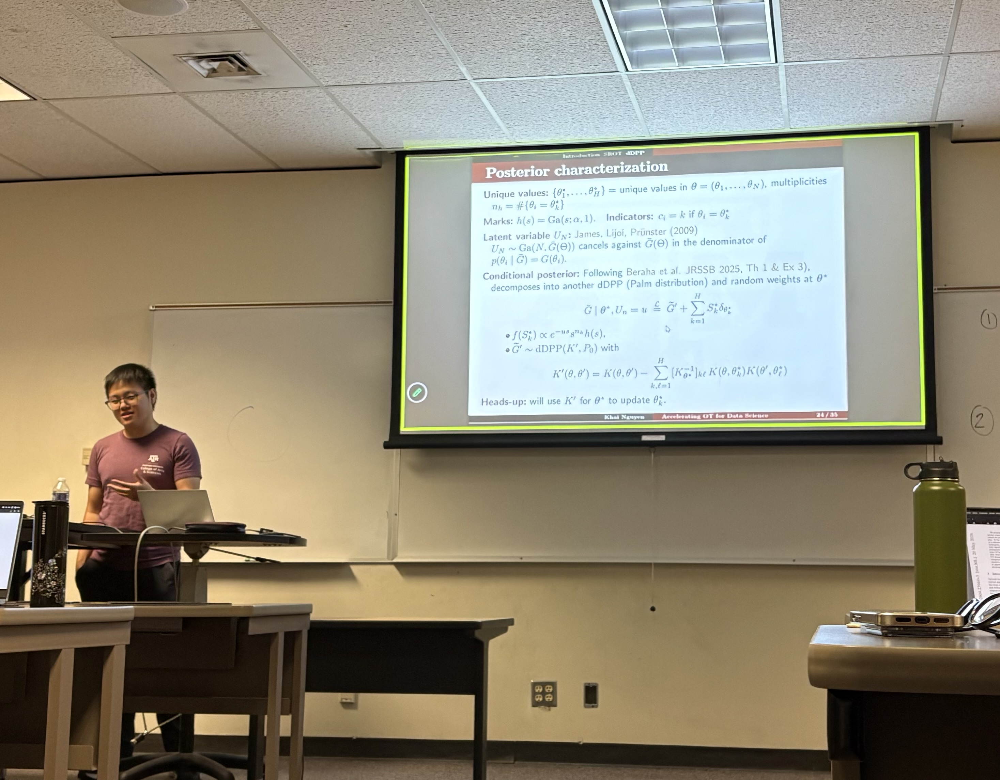

<!--
 
-->

### Consistent Spatial Clustering of Complex Objects via Bregman Geometry

- Time: Tuesday, 11/17/2026 from 11:10AM to 12:25PM
- Location: BLOC 448

[RSVP Link](<https://docs.google.com/forms/d/e/1FAIpQLSdSjWMaGNrA1zCaDh_5E08g8phngaBmgLiCalyloUn_s4YONA/viewform>)

[Zoom Link](<https://tamu.zoom.us/j/95358404036?pwd=aKGbZrMI8DlOuTvKXaabFQPyrYsPnM.1>)

### Description

Spatial clustering of complex-object data presents challenges when conventional parametric likelihoods are difficult to specify. We develop a generalized Bayesian framework for identifying spatially contiguous clusters of complex objects, including probability distributions, networks, and structured matrices. The proposed method uses Bregman divergences to measure within-cluster heterogeneity, geometry-matched priors for tractable marginalization, and a spanning-tree partition prior to enforce spatial contiguity. We establish posterior consistency for spatial partitions and cluster representatives under infill-domain asymptotics. Simulation studies demonstrate accurate recovery of spatial clusters, while an application to racial-composition data from Houston identifies geographically coherent clusters with distinct demographic compositions.

### Our Speaker

Srijato Bhattacharyya is a fifth-year Ph.D. student in Statistics advised by Dr. Huiyan Sang and Dr. Bani Mallick. Before joining Texas A&M, he received an M.Stat. from the Indian Statistical Institute and a B.Sc. in Statistics from Presidency University, Kolkata. His research focuses on Bayesian spatial modeling, with applications in demography and public health.

<!--
### Presentation
<iframe src="https://drive.google.com/file/d/1tN9MfS-UIcedYkMafjpg1VxsRcSM0t8T/preview" width="640" height="480" allow="autoplay"></iframe>
-->

<!--
### Recording
<iframe width="560" height="315" src="https://www.youtube.com/embed/hEnEmymzzU0?si=wj7aBvE_v2OlDE-k" title="YouTube video player" frameborder="0" allow="accelerometer; autoplay; clipboard-write; encrypted-media; gyroscope; picture-in-picture; web-share" referrerpolicy="strict-origin-when-cross-origin" allowfullscreen></iframe>
-->

<!--
### Gallery


-->

