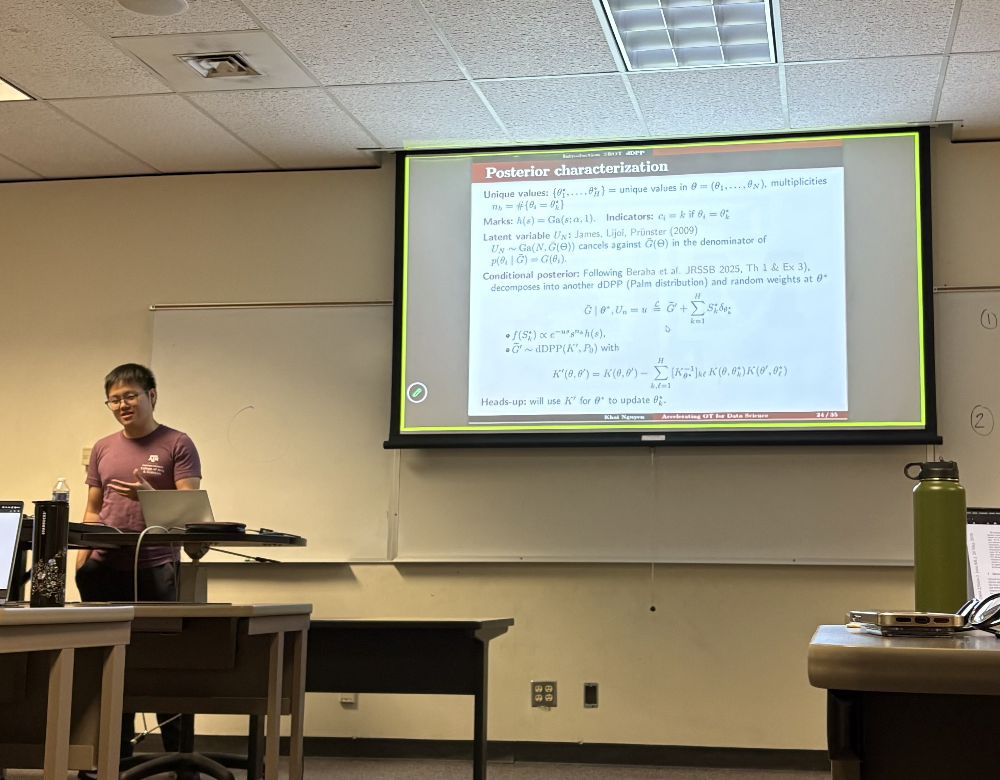

<!--
 
-->

### Statistical Inference for boundary constrained parameters

- Time: Tuesday, 11/24/2026 from 11:10AM to 12:25PM
- Location: BLOC 448

[RSVP Link](<https://urldefense.com/v3/__https://forms.gle/x8FExaQbcM4Ryycy8__;!!KwNVnqRv!CeWMfDQymIbpTqjkMONPlh2wBowt2Apohws7cQ6M8xZ-BvtUPxpCmPZfc2injmB7MRsOkd_YEVUuQvAJ6ivN-D8$>)

[Zoom Link](<https://tamu.zoom.us/j/95358404036?pwd=aKGbZrMI8DlOuTvKXaabFQPyrYsPnM.1>)

### Description

Estimation and Inference under boundary constraints arise in many areas of statistics, but asymptotic theory remains fragmented relative to the classical interior case. We derive a boundary-constrained analogue of the standard asymptotic expansion for a loss minimiser, decomposing the estimator’s deviation from the population parameter over lower-dimensional subspaces determined by directional derivatives at the minimiser. Using this decomposition we show the limiting distribution is a mixture of point masses and truncated skewed normal distributions with mixture probabilities determined by the directional derivative conditions. We derive the asymptotic distribution of quasi log-likelihood ratio under various null hypotheses and propose a simulation-based approach for approximating critical values for the nonpivotal mixture. We illustrate our results by testing for interactions in exponential family graphical models under compatibility constraints that ensure a joint distribution exists.

### Our Speaker

Jaeson Lee is a 4th year Statistics PhD student at Texas A&M advised by Dr. Suhasini Subba Rao. His research primarily focuses on time series analysis, graphical models for time series, spectral analysis on dependent data, and estimation and inference on boundary. He received a B.A. in Economics, B.S. in Mathematics and M.S. in Statistics from Hanyang University, Seoul, South Korea. 

<!--
### Presentation
<iframe src="https://drive.google.com/file/d/1tN9MfS-UIcedYkMafjpg1VxsRcSM0t8T/preview" width="640" height="480" allow="autoplay"></iframe>
-->

<!--
### Recording
<iframe width="560" height="315" src="https://www.youtube.com/embed/hEnEmymzzU0?si=wj7aBvE_v2OlDE-k" title="YouTube video player" frameborder="0" allow="accelerometer; autoplay; clipboard-write; encrypted-media; gyroscope; picture-in-picture; web-share" referrerpolicy="strict-origin-when-cross-origin" allowfullscreen></iframe>
-->

<!--
### Gallery


-->

