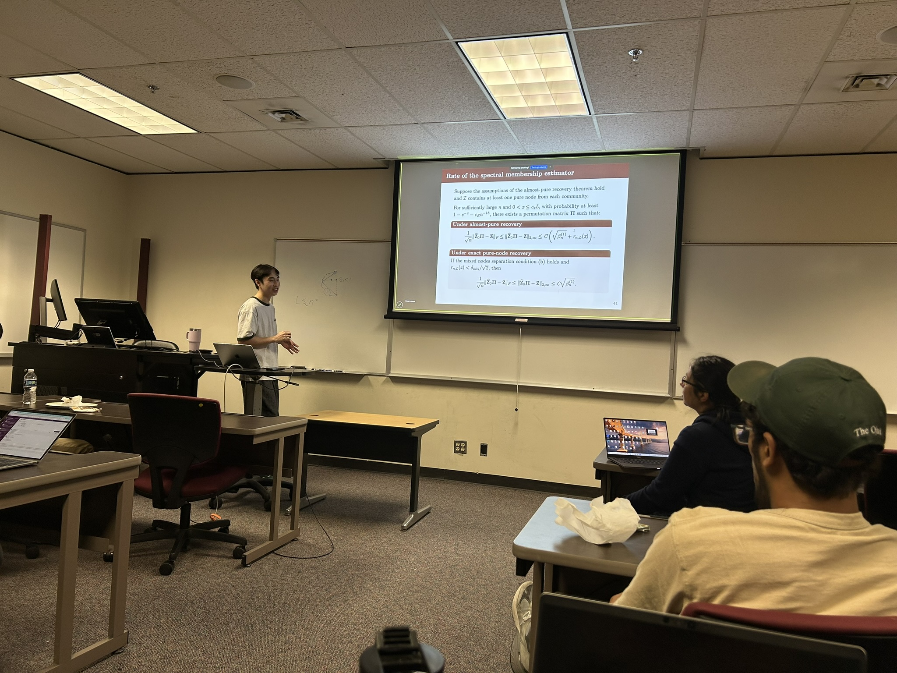

 

### Identifiability and Spectral Estimation of Mixed Memberships in Heterogeneous Multilayer Networks

- Time: Tuesday, 11/24/2026 from 11:10AM to 12:25PM
- Location: BLOC 448

[RSVP Link](<https://urldefense.com/v3/__https://forms.gle/x8FExaQbcM4Ryycy8__;!!KwNVnqRv!CeWMfDQymIbpTqjkMONPlh2wBowt2Apohws7cQ6M8xZ-BvtUPxpCmPZfc2injmB7MRsOkd_YEVUuQvAJ6ivN-D8$>)

[Zoom Link](<https://tamu.zoom.us/j/95358404036?pwd=aKGbZrMI8DlOuTvKXaabFQPyrYsPnM.1>)

### Description

Multilayer network data is increasingly common these days. In this talk, I will introduce a multilayer degree-corrected mixed-membership model (ML-DCMM), a multilayer generalization of the Stochastic Blockmodel (SBM) that accommodates degree heterogeneity and mixed memberships. Community detection, which aims to identify groups of nodes with similar connectivity patterns, is a fundamental task in network analysis. I'll discuss non-identifiability issues in several block models and provide a sufficient condition for the identifiability of ML-DCMM. Next, I will introduce a computationally efficient spectral method for community detection using the latent geometry of ML-DCMM. I will illustrate the proposed method using London bike-sharing data.

### Our Speaker

Taeseok Park is a 4th year Statistics PhD student at Texas A&M advised by Dr. Jesús Arroyo. His research primarily focuses on network data analysis, random matrix theory, and high-dimensional statistics. He received a B.A. in Psychology and Applied Statistics, and M.S. in Statistics from Yonsei University, Seoul, South Korea.

<!--
### Presentation
<iframe src="https://drive.google.com/file/d/1tN9MfS-UIcedYkMafjpg1VxsRcSM0t8T/preview" width="640" height="480" allow="autoplay"></iframe>
-->

<!--
### Recording
<iframe width="560" height="315" src="https://www.youtube.com/embed/hEnEmymzzU0?si=wj7aBvE_v2OlDE-k" title="YouTube video player" frameborder="0" allow="accelerometer; autoplay; clipboard-write; encrypted-media; gyroscope; picture-in-picture; web-share" referrerpolicy="strict-origin-when-cross-origin" allowfullscreen></iframe>
-->

### Gallery



